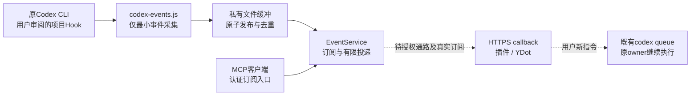

# YDot事件桥接实现与验证

> C1状态：用户取消真实接入，客户端、配置和事件状态已可恢复归档，磁盘与原会话运行Hook清单均为0；源码和以下历史验收证据保留，不表示仍在运行。清理详见[YDot安全接入操作清单第9节](YDot安全接入操作清单.md#9-c1取消接入与可恢复清理)。

任务标记：`YDOT-EVENT-BRIDGE-20261031-IMPL1`。本项为0.5.0工程内的独立本地增量，代码直接由原维护会话开发，未委派其他Agent。未接管其他业务协调器。

## 1. 交付结论与验证分层

项目级观察Hook、离线事件缓冲、MCP Events订阅、签名回调及本地认证HTTP入口已实现。已有Codex队列RPC保持原样，用户返回指令仍走原队列，不新增远程shell或队列写工具。

| 链路层次 | 本轮结果 |
| --- | --- |
| 现有CLI身份与版本 | 目标原CLI进程使用0.166.0，hooks特性开启；历史会话元数据0.164.0不代表当前二进制 |
| 原生Hook定义 | 按当前官方JSON及commandWindows构造；已按后续授权合并原项目配置并备份，未绕过信任审阅 |
| Hook脚本 | 使用官方形状的模拟Stop、PermissionRequest、Interrupt输入测试，零退出码、有效空JSON对象、不裁决任务；Windows命令转发真实执行通过 |
| 本地MCP HTTP | 在临时回环端口实际测试认证、发现、订阅、撤订及只读工具；测试后关闭监听器及自己的归属记录 |
| HTTPS回调与故障 | 签名、挑战、DNS校验、拒绝重定向、重试及离线恢复采用受控替身测试，未向外网真实投递 |
| 当前原CLI热加载/真实事件 | 未验证；后续授权已允许普通项目合并，信任仍由用户操作，未替用户审批、不重启或抢占原CLI |
| MCP插件与YDot真实唤醒 | 未测试：无已授权接入通道、插件订阅或真实回调；未虚构可唤醒YDot的URL |

此前两轮队列往返及有界历史检查证明的是消息投递/答复回收，不替代本项事件推送验收。`queued`、单回合完成、整个工程完成及YDot实际处理是不同状态。

## 2. 数据路径与模块



| 文件 | 职责 |
| --- | --- |
| agent-bridge/hooks/codex-events.js | stdin JSON采集；不访问网络、不启动模型；成功、过滤及可控错误均返回{}，内部700ms预算，零退出且不输出控制字段 |
| agent-bridge/lib/events/store.js | session与真实cwd双重allowlist、最小字段、稳定事件ID、原子去重和有容量限制的缓冲 |
| agent-bridge/lib/events/service.js | events/list、subscribe、unsubscribe的业务语义；挑战验证、密钥轮换、过期、撤销访问和持久重试 |
| agent-bridge/lib/events/webhook.js | Standard Webhooks HMAC、回调校验、每次DNS解析与地址固定、HTTPS短超时及禁止重定向 |
| agent-bridge/lib/events/server.js | 同一认证MCP端点；仅events协议、ping与只读bridge_status工具 |
| agent-bridge/lib/events/hook-config.js | 项目Hook合并及精确移除，保留用户其他策略 |
| agent-bridge/bin/codex-events.js | 配置预览/应用/移除；显式前台回环HTTP服务，无安装守护进程 |
| agent-bridge/test/events.test.js | 本项定向验证，所有回调、身份和密钥均为本地测试数据 |

## 3. 事件与权限边界

allowlist同时精确匹配原生session和规范化真实目录，不允许通配所有会话。远程事件仅含target_id、turn_id、事件类型和状态；审批事件额外含工具名及不可逆请求指纹。完整提示词、代码、最后回复、transcript_path、原始命令和工具输入均不进入事件记录或回调。相同审批指纹可去重，实际待审批详情仍应回原CLI查看。

| Hook | MCP事件 | 含义 |
| --- | --- | --- |
| Stop | codex.stop.observed | 观察到停止边界，其他Hook仍可能要求继续，不直接确认最终完成 |
| PermissionRequest | codex.permission.requested | 有审批请求，只通知；不返回allow/deny |
| Interrupt | codex.turn.interrupted | 回合被中断，不推导任务成功或失败 |

三个Handler均为async、timeout=3秒，脚本统一输出有效JSON对象`{}`，不返回block、continue、allow、deny或其他权限决定。覆盖正常采集、过滤、坏JSON、缺配置、输入超限及输入超时路径。Interrupt的3秒上限符合当前官方约束。其他原有Hook仍各自执行，桥接不修改其裁决。

官方通用输出章节同时说明空输出可视为成功，但Stop专节要求退出0时输出JSON。本桥接按该更严格契约实施，不再以空字符串断言代替有效格式验证；async使用相同事件输出格式。此为同一任务的本地验收补修，不代表已在原CLI实际触发Hook。

Stop事件保留stop_hook_active；最新回复仅参与不可逆指纹，不存正文。相同Stop重复输入去重，继续后的不同Stop允许形成新事件。消费方应在事件唤醒后按既有授权读取对应原会话的最后答复进行对账，不以定期LLM读历史替代推送。原生Stop本身不足以证明其他停止Hook已经全部收口，故本桥接不声称提供未经确认的最终完成状态。

## 4. 订阅与投递保证

MCP采用Streamable HTTP初始化协议2025-03-26，并声明events能力。事件定义、订阅及只读工具共用同一认证端点。未宣称实现完整MCP 2.0。客户端身份由服务端配置决定，不接受客户端自行指定principal。

订阅ID来自principal、规范化callback URL、事件名和规范化过滤参数。刷新保持ID；挑战验证成功后才激活，撤订不能被迟到挑战响应恢复。whsec签名材料须解码为24至64字节；轮换时5分钟内双签。缺省1小时、最多24小时，ttlMs:null也仅授予有限有效期。过期、撤订或撤销访问后停止后续投递并去除该订阅中的签名材料。

每个事件最多尝试5次，指数退避1、2、4、8秒，延迟上限30秒，ID和事件正文保持，签名时间重新生成。410和413不重试；接收方已处理但回复丢失时仍可能收到相同eventId，因此是至少一次语义，不承诺exactly-once。订阅撤销不能收回已经在途的HTTP请求。

程序每秒处理持久缓冲及到期重试，不调用LLM读取会话历史。缺省缓冲阈值2000条，保留期7天；满时丢弃新事件并写本地buffer_full健康记录。已存在订阅的离线重试可恢复；cursor始终null，不提供MCP历史重放，首次订阅、撤订或过期空窗不保证补发。

回调仅允许HTTPS/443，无用户密码或fragment；连接前重新解析DNS，拒绝私有、回环、链路本地、映射地址及保留范围，并固定连接到验证过的地址，保留原主机名和TLS验证。挑战与正式投递共用该路径，所有重定向不跟随。响应大小有上限，DNS及HTTP阶段分别短超时。

## 5. 配置与启动

不引入第三方依赖，使用工程现有Node环境及内置模块。配置示例位于agent-bridge/examples/codex-events/config.example.json，必须替换占位符并存私有目录；占位配置不能直接启动。

本轮已在维护项目`.local/ydot-event-bridge-20261031/config.json`准备仅限原owner及原cwd的私有allowlist，未创建任何访问凭据。Hook预览位于同目录hooks-preview.json，目标为原CLI实际项目层；代码仍留在桥接项目内。原会话cwd位于桥接仓库的父目录，不能假设子项目Hook自动生效。

配置边界补充授权后，已实际合并原项目`.codex/hooks.json`，每个目标事件只含一份本项Handler，原文件此前不存在。备份位于私有state目录hooks-backup-*.json，应用证据见hooks-applied-proof.json。信任、真实触发及云端步骤均未因此获批或执行。具体Tunnel权限、凭据、命令模板、插件订阅验证和停止撤销步骤见[YDot安全接入操作清单](YDot安全接入操作清单.md)。

精确Windows命令、三项Handler、原session/cwd的allowlist、父目录绝对路径及回滚命令另存同目录`local-activation-preview.json`；该文件保留前次预览，实际应用以hooks-applied-proof.json为准，未执行回滚。查看实际生成的命令：

```powershell
(Get-Content .local/ydot-event-bridge-20261031/local-activation-preview.json -Raw | ConvertFrom-Json).commandWindows
```

```powershell
$config = '.local/ydot-event-bridge-20261031/config.json'
$entry = 'agent-bridge/bin/codex-events.js'
node $entry hooks --config $config --project '<原CLI项目根>'
# Review preview, then apply only within the authorized project. / 审阅预览后，仅向授权项目应用。
node $entry hooks --config $config --project '<原CLI项目根>' --apply
```

应用只追加本项定义并备份原项目Hook，不改全局配置。原CLI中仍需通过/hooks审阅信任精确的新增定义；不使用绕过信任参数，不自动写信任记录，也不关闭CLI。当前文档未给出可在本场景无交互保证热加载的承诺。

前台服务仅在明确提供授权认证环境后启动：

```powershell
# EVENT_BRIDGE_TOKEN must be explicitly provisioned by an authorized operator. / EVENT_BRIDGE_TOKEN必须由获授权的操作者明确提供。
node $entry serve --config $config --port 42589
```

服务默认仅监听127.0.0.1，不开放公网，不自动创建隧道或后台服务；认证缺失时拒绝启动。此loopback地址不是可供云端YDot访问的MCP URL。正式接入还需批准安全MCP通道及其凭据/认证方式，再连接支持Events的插件，由客户端供应实际callback URL和签名材料。未读取现有凭据，未生成持久token或新OAuth授权。

未来真实订阅会持久化客户端提供的签名材料，目录必须保持私有；POSIX文件使用0600/0700，Windows还需由部署者落实私有ACL。当前没有真实签名材料。服务异常退出若留下归属文件会拒绝第二实例，不自动删锁或抢owner；须先核实原进程状态再显式维护。

## 6. 验证与剩余动作

定向命令：`node --test agent-bridge/test/events.test.js`。覆盖正常完成、稳定去重、非目标过滤、断网/500重试、410/413、到期、撤订、撤销访问、密钥轮换、挑战撤销竞态、审批仅通知、Windows命令、SSRF/DNS重绑定、认证及本地服务清理。

本地验收补修后的最终结果：定向20/20，`npm test`为152/152，`npm run test:e2e`为8/8；全量包含原有未提交工作。已跟踪134文件公开检查为0发现，新增源码及说明另行检查。原有26个源码/原交付文件哈希不变，README/台账/会话记录只增加本项说明或更新本项结果。简短证据见私有目录`local-acceptance-results.json`及acceptance-*.log。前次18/150是补修前结果，不替代本次结果。

测试中的Stop、审批和Interrupt为官方形状的样本输入，不是本原生CLI已触发这些Hook的证据。本地HTTP请求为真实回环调用，callback为模拟替身，不能写成YDot收到真实事件。所有测试监听器、订阅测试目录及子进程在测试结束后清理，未留下持续监控服务。

### 6.1 2026-10-31原生Stop补验

用户正常恢复原会话并完成启动阶段的Hook信任审阅后，官方hooks/list对当前原会话返回三个project来源Handler，均为trusted且enabled，无警告或错误。启动审阅与/hooks均为信任入口；定义按配置层发现，信任绑定定义哈希，运行会话持有已加载清单。此前新增配置时旧会话清单为空，不能把Installed=0误当作按键或信任开关问题。已加载Handler可在/hooks管理，不据此次新增配置的刷新问题推导每次开关均须重启。

原会话一次自然结束回复实际产生codex.stop.observed，已与仅该owner的原生回合及最终回复不可逆指纹核对，事件完整一致；落盘时间为2026-10-31 20:32:27（UTC+8），晚于原生task_complete记录663ms。该时间仅为本次样本，不是延迟保证。采集器仍不读取会话历史；只读核对由本次独立验收脚本完成，未保存回复正文或扩大allowlist。

私有复验命令为node .local/ydot-event-bridge-20261031/verify-native-stop.cjs <原owner的rollout文件>，结果位于同目录native-stop-verification.json。脚本仅使用已经存在的真实事件，在隔离状态目录中重建输入并验证原事件ID，不向真实缓冲重投、补造事件或注册真实订阅。真实回环HTTP的initialize、事件发现、订阅与刷新、撤订通过；mock callback通过签名挑战，模拟离线后跨实例持久重试成功，重复事件仍只有一条投递。测试监听器关闭，隔离目录移除；真实订阅与投递数均为零，未启动正式服务或连接外网。原有26个源码及交付文件哈希不变。

专项命令node --test agent-bridge/test/events.test.js再次执行20/20通过。全量152/152及既有验收8/8沿用本项先前结果；本次未改运行源码，未将历史结果描述为再次全跑。原生Stop真实采集通过，实际PermissionRequest与Interrupt尚未触发；相关仅通知语义当前仍由fixture回归覆盖，不改变审批策略或故意中断原会话。

真实YDot闭环仍需安全MCP接入、受保护认证及插件订阅；当前工具无可用Events订阅入口，本地亦无真实订阅/投递。必须分别取得真实callback接收及YDot实际唤醒摘要证据，才能补云端通过；本地mock验收不替代它们。审批真实验证等待自然且已授权的请求，不故意制造危险审批。


## 7. 回滚

```powershell
node $entry hooks --config $config --project '<实际应用的项目根>' --apply --remove
```

移除只匹配本项精确定义，保留其他Hook及用户修改；生成时路径须与安装时相同。配置应用备份保存在私有state目录hooks-backup-*.json，需要完整恢复时先比较差异，不能覆盖之后的用户改动。真实订阅须先由客户端events/unsubscribe撤订，再停止本项前台服务；只停止本项进程，不影响原CLI或共享服务。当前未运行正式服务、未建立真实订阅，因此没有需要撤销的外部授权。

## 8. 接口依据

- [官方Codex Hooks](https://learn.chatgpt.com/docs/hooks)：项目配置、Windows命令、stdin JSON、观察输出及信任审阅。
- [官方MCP Events](https://developers.openai.com/plugins/build/mcp-events)：订阅协议、签名、挑战、callback安全及Work/dot适用范围。
- [官方Secure MCP Tunnel](https://developers.openai.com/api/docs/guides/secure-mcp-tunnels)：后续可评估的安全通路，本轮未创建。
- [WorkDone Events说明](https://github.com/ivorpad/workdone/blob/main/docs/mcp-events.md)及mcp/src/hooks.ts仅作为对照；未安装WorkDone，也未引入其默认权限配置。
