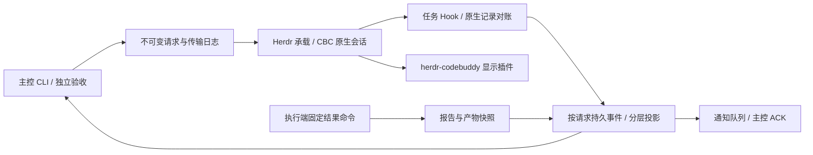

# 分层任务协议详细设计

状态：设计基线；实现与测试结果分别记录，不将设计视为已实现。

## 请求与事件

显示插件与任务协议不存在互相冒充的状态写入口。主控读取冻结结果作验收；下一次派工另行核对当前承载和写入资源。

每次尝试由协调器生成不可变request：protocol、taskId、round、requestId、agent、specSha256、promptSha256、绑定的原生会话/Pane/terminal/启动身份、允许产物范围。requestId复用已有attemptId；新轮次新ID；未知请求禁止通过生成新ID重发。

事件包含schemaVersion、eventId、source、kind、requestId、taskId、round、replyTo、payload、createdAt。source由调用角色确定，外部原始输入不能自称controller。身份字段与request比较；同source+eventId同内容幂等，不同内容报冲突。事件与投影同一次原子写入，先落发送意图再传输。响应丢失仅对账，不能自动重发。

## 正交状态及唯一写入归属

- transport：prepared/sending/written/unknown/rejected/admitted，由传输及原生准入证据驱动。
- execution：not_started/unknown/running/blocked/ended，由绑定请求的执行事件驱动。failed为执行结果之一，不能由连接错误推出。
- observation：healthy/unavailable/conflict，不反向擦除已确认结果。
- review：not_ready/pending/accepted/changes_requested，由冻结交付和主控决定驱动。
- resource：unknown/held/released/conflict，仅决定新任务准入与安全控制，不影响历史结果能否审阅。
- control：open/cancel_requested/closed/abandoned，记录主控协调操作；abandoned保留资源隔离，不将未知执行伪装为终止。

兼容task.status由上述维度投影，原始证据与分层状态为准。事件迟到不回退终态；缺少因果前件的事件留待对账，不提前宣布完成。运行中相反终态或同ID不同内容报冲突，不能最后写入者获胜。

## CBC封装

现有发送前进程/租约/审批守卫保留。新CBC请求注入固定完成命令，执行端只提供outcome/reason和产物路径，不选择task/round、不改任务状态。结果命令读取不可变请求并计算摘要/拷贝快照，由程序生成结构化交付。

Hook按精确UserPromptSubmit任务指针确认接纳。每原生会话登记当前输入归属，人工未匹配输入使当前执行归属变为外部，后续Stop不能冒领旧任务。已结束请求保持结束证据；其他会话的事件不进入该请求。Hook证据按请求分文件，坏记录仅阻止该请求，不连带其他任务；状态更新不依赖全局日志容量或mtime缓存。

结果声明和精确Stop二者到齐才能产生review_pending，到达顺序不影响结论。报告/产物冻结在请求目录，记录源路径、字节数、sha256；后续用户操作不会改写快照。若源已变，accept明确检查快照版本，不把当前源当旧版本；新派工另行检查占用、审批、身份和写范围。没有结构化结果或身份/时间对不上时保持未决并给精确诊断，不从idle猜完成。

原生身份校验与任务归属不同：同session的Hook不一定属于同task。已确认Stop之后的手工输入不能回溯否定历史交付；Stop之前的外来输入导致当前请求归属不确定，不把其结果或Stop算入原请求。/status等本地管理记录不改变任务声明。

## 存储与并发

任务轮次目录下按requestId独立存request、事件、冻结artifact及诊断，投影按事件计算。请求不可覆盖；原子写临时文件+rename，事件写入前验证Schema与因果；多进程采用现有内核锁并规范化真实路径。锁顺序task→request，不允许request→task；Hook不写任务投影，通知在任务锁外。返工新请求保存前轮request摘要引用，旧交付与失败记录不改写。

有界日志与附件大小；超过限制显式诊断，不删证据。重复心跳不累积事件；结果或消息重试须相同幂等ID。断电边界依赖文件系统，不声称跨设备事务；重启以已落盘事件重建投影，无证据不推断未发送。

## 恢复与通知

status显示全部维度与下一步；recover只验证/重建投影及恢复观察，不重新提交。明确未发送可在当前worker就绪后显式继续；sending/unknown先对账。审批只通知；429/配额/网络分别记录，不自动换模型。cancel请求和取消确认分离；未知资源保留隔离，解除必须有精确新证据。

通知复用持久outbox及queue/ack；事件键绑定request和状态修订。队列回执不等于业务消费，ack不等于accept。重投预算有界，耗尽显示原因和显式重启通知入口；不能借通知失败回退任务结果。

## 发布与旧任务

新能力只对明确登记的新请求生效。旧请求继续原协议，禁止凭手动交付补造新接纳。需迁移时先只读预检、冻结原证据、无活跃执行后采用带来源审计的导入；证据不足则保留旧入口处理。发布保留上一版本及清单，运行中worker不强制重载。技能只描述高层派工/审查，底层协议由CLI自动执行。
